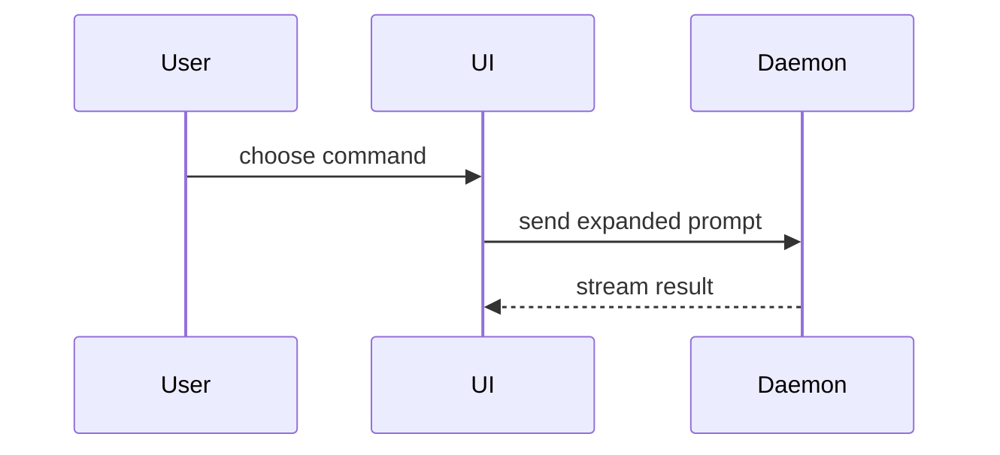

Help the user understand the current topic. Start from the reader's question and the available evidence. Choose the smallest representation that adds comprehension value; do not add a visual only to decorate the answer.

## Decide before authoring
- Research the facts first. Assess a concrete explanation passage, not only the initial request. Keep the reader's question, supported facts, destination, and output constraints explicit.
- Read `references/visual-assessment.md` and use its Jev assessment before selecting a representation. Jev selects a broad representation; you choose the exact syntax and author it. Do not send Jev the full Mermaid syntax guide.
- If the user explicitly selects a representation, honor that choice when the evidence and destination support it; no Jev call is needed. Explain missing evidence instead of inventing facts to complete the shape.
- A prose route is a successful assessment, not an instruction to try again. An unavailable assessment is not a prose judgment: use your own judgment and distinguish the fallback if reporting how the representation was selected.
- Ground every node, arrow, comparison cell, and measurement in the evidence. Keep unknown relationships in prose and label proposed behavior as proposed.
- Respect the requested output format. Prefer text trees, tables, diffs, and pseudocode for terminal output. Use Mermaid only when the destination supports it. Do not create files or open a browser for a chat-only or read-only request.
- Start with one focused representation. Add another only when it answers a different part of the reader's question. Put a short takeaway beside each visual rather than repeating the same explanation in prose.

## Author the selected representation
- Show logic or an algorithm as pseudocode:

```text
on(save)
  if content is unchanged
    return cached result
  write new content
  return fresh result
```

- Show runtime control flow as a call tree:

```text
submitForm
  createSession
    persistPrompt
    launchAgent
  navigateToSession
```

- Show UI structure as a component tree, including state and module boundaries that matter:

```tsx
<SessionPage> (apps/example/src/routes/session.tsx)
  useSessionEvents()
  <SessionToolbar>
    <RunSkillButton> (packages/ui)
```

- Show file responsibility or a broad refactor as a shallow file tree:

```text
src/
├── commands/       # parses user actions
├── sessions/       # owns session state
└── transport/      # sends API requests
```

- Before emitting a Mermaid diagram, load and follow `mermaid-best-practices` when that skill is available.

- Show component interaction, control flow, or data flow with Mermaid:



- Use `diff` when the point is what changes and the surrounding shape already exists. Match the diff shape to the topic.

For a component change:

```diff
 <SessionPage>
   useSessionEvents()
   <SessionToolbar>
+    <RunSkillButton />
   <SessionTimeline>
+    <SkillResultCard />
```

For a file-layout change:

```diff
 src/
 ├── commands/
+│   └── explain.ts       # expands the slash command
 ├── sessions/
-└── transport.ts
+└── transport/
+    ├── client.ts
+    └── stream.ts
```

For a call-tree or call-stack change:

```diff
 submitForm
   createSession
     persistPrompt
+    expandSkillMention
     launchAgent
-  navigateToSession
+  navigateToSession
+    subscribeToEvents
```

For a state or control-flow change:

```diff
 on(save)
-  write content
+  if content is unchanged
+    return cached result
+  write content
+  invalidate cache
```

- Show the whole block when most of it is new, when omitted context would hide ownership or order, or when the user needs a copyable target shape:

```ts
function expandSkill(command: string): string {
  const skillName = command.slice(1)
  return `use the ${skillName} skill`
}
```

- When browser output and file creation fit the request, use one focused HTML file for a visual UI, layout, state comparison, or concept too dense for the simpler representations — a diagram, an infographic, or a short slide deck, whichever fits the point. Match the product's colors, type, spacing, and components; use real labels and data; support desktop and mobile. Then open it for the user with the bash tool:

```text
open path/to/explain-{description}.html
```

- Place each visual next to the short text it supports. Keep only the calls, files, props, states, and boundaries needed to answer the user's current question.

Use prose when no supported representation improves understanding. Do not generate extra visuals to fill the catalog.
