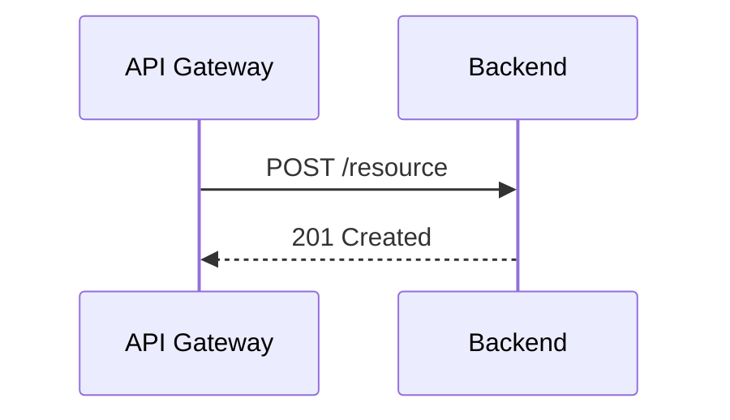
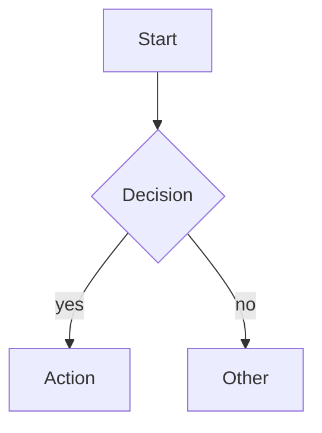
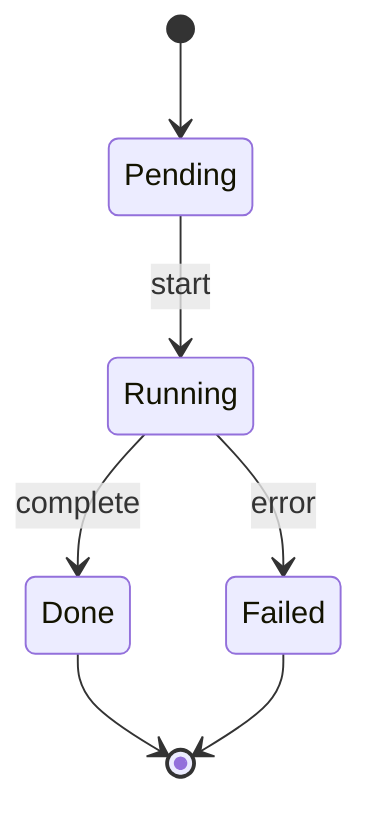
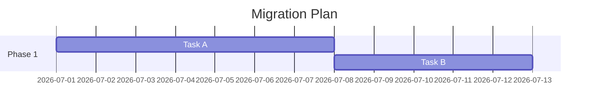

# Mermaid Best Practices
Use for `.mmd` files and fenced ` ```mermaid ` blocks. Output fenced code blocks unless writing a standalone `.mmd` file.

## Choose the right diagram
| Need | Type |
|---|---|
| Service/API interaction | `sequenceDiagram` |
| Decisions, pipelines, topology | `flowchart TD` or `flowchart LR` |
| Type or data model | `classDiagram` or `erDiagram` |
| Lifecycle/state machine | `stateDiagram-v2` |
| Time-series or category comparison | `xychart-beta` |
| Schedule | `gantt` |
| Timeline | `timeline` |
| Infrastructure topology | `architecture-beta` |
| Branch history | `gitGraph` |

## Syntax patterns
Sequence:


Flowchart:


State:


Gantt:


## Rules
- Keep one concept per diagram. Split large diagrams.
- Use short labels; put detail in prose or notes.
- Make node IDs unique. Labels may repeat.
- Quote labels containing `:`, `#`, `/`, `&`, `?`, `=`, or `(`.
- Valid flowchart arrow syntax is `-->`, `-.->`, `<-->`, or `---`. Never write `<--` (for example, `A <--|"label"| B`), which is a syntax error in Mermaid flowcharts; write `B -->|"label"| A` instead.
- Do not put raw `<placeholder>` angle brackets inside node or edge labels — Mermaid's HTML sanitizer strips `<tag>` as an HTML tag (for example, `"<namespace>/foo"` renders as `"/foo"`). Use plain text (`namespace/foo`), parentheses (`(namespace)/foo`), or HTML entities (`&lt;namespace&gt;/foo`).
- Do not create two-node cycles (`A -->|"request"| B` and `B -->|"response"| A`) in `flowchart LR` or `flowchart TD`. Dagre ranks nodes by incoming edges, which reverses node order, stacks the forward and return labels on top of each other, and clips text under node boxes. Split the outcomes into distinct forward nodes (`A --> B --> Deny["403 Forbidden"]` and `B --> Allow["Next authorizer"]`) instead of routing an edge back to `A`.
- Keep `flowchart LR` to at most 3–4 horizontal ranks so the diagram fits standard GitHub and Confluence viewport heights and widths without clipping or colliding with zoom controls.
- On GitHub, `sequenceDiagram` renders actor boxes at both the top and bottom by default and overflows the fixed container height once `alt`/`else` blocks are added; either add `autonumber` / `%%{init: {'sequence': {'mirrorActors': false}}}%%` or prefer a 3-rank forward `flowchart LR` for simple decision forks.
- Avoid subgraphs deeper than two levels.
- In sequence diagrams, declare readable participants with `participant X as Label`.
- In sequence-diagram message labels, escape semicolons as `#59;` when the renderer treats `;` as a statement separator.
- In flowcharts, choose one edge-label style and stick to it.
- For `xychart-beta`, data point count must match category count.
- For `gantt`, always set `dateFormat` and use `after <id>` for dependencies.
- For Obsidian note links in Mermaid, add `class NodeName internal-link;`.

## Before finishing
- Verify every referenced node is declared.
- Add a title when the diagram will stand alone in docs or Confluence.
- Note beta diagram types (`xychart-beta`, `sankey-beta`, `architecture-beta`) if syntax risk matters.
